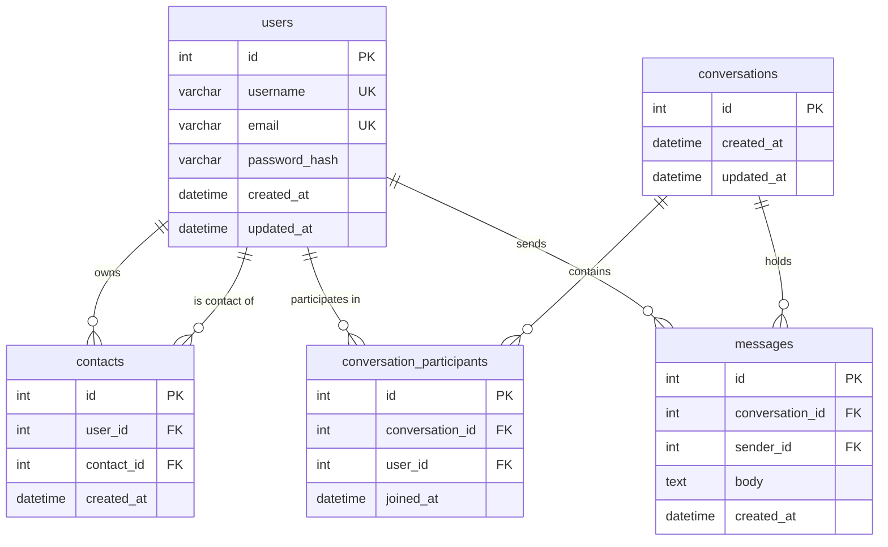

# Project Exodia — Web-Based Messaging Application

**Project Exodia** is an enterprise-grade, secure direct messaging platform developed for university Web Technologies evaluation. Built strictly within the native **LAMP stack** (Linux, Apache, MySQL, PHP) with zero external frameworks, Project Exodia delivers end-to-end user authentication, directory-based operative discovery, contact management, and near-real-time encrypted direct messaging.

---

## 1. Technology Restrictions & Compliance

This project complies strictly with all university coursework guidelines and LAMP architectural standards:

| Component | Technology | Compliance & Implementation Details |
| :--- | :--- | :--- |
| **Operating System** | Ubuntu Linux | Native LAMP environment |
| **Web Server** | Apache HTTP Server 2.4 | Port 80 virtual host / also tested with native PHP CLI server (`php -S`) |
| **Backend Language** | PHP 8.3 | Strict typing (`declare(strict_types=1)`), PDO prepared statements, native sessions |
| **Database** | MySQL 8.0 | `utf8mb4` character set, `utf8mb4_unicode_ci` collation, InnoDB foreign keys with `ON DELETE CASCADE` |
| **Frontend Markup** | HTML5 | Accessible semantic markup, ARIA roles, landmarks, responsive viewport |
| **Frontend Styling** | CSS3 (Vanilla) | Custom dark futuristic design system, CSS custom properties, responsive flexbox & grid |
| **Frontend Interactivity**| Vanilla JavaScript (ES6+)| Fetch API, DOM manipulation, accessible toggles, near-real-time AJAX polling, zero libraries |
| **Version Control** | Git & GitHub | Multi-branch feature development, pull requests, no exposed secrets |

**Explicit Framework Exclusions Enforced:**
Strictly **NO** Node.js runtime, npm dependencies, React, Vue, Angular, Next.js, Laravel, Symfony, Bootstrap, Tailwind CSS, Firebase, Supabase, WebSockets servers, or external auth APIs.

---

## 2. Complete Architecture & Directory Structure

```text
Web-Project/
├── config/
│   ├── config.example.php                # Safe configuration template (tracked in Git)
│   ├── config.php                        # Untracked local configuration (.gitignore protected)
│   └── database.php                      # Singleton PDO database factory with native prepares
├── database/
│   ├── migrations/
│   │   ├── 002_create_contacts_table.sql # Phase 2 contacts table migration
│   │   └── 003_create_messaging_tables.sql# Phase 3 conversations & messages migration
│   └── schema.sql                        # Complete MySQL DDL schema (all 5 tables)
├── includes/
│   ├── auth.php                          # Auth guards (require_login, require_auth_api, is_authenticated)
│   ├── contacts.php                      # User discovery & contact management business logic
│   ├── csrf.php                          # 32-byte cryptographically secure CSRF token engine
│   ├── messaging.php                     # Conversations, messages, and polling business logic
│   ├── session.php                       # Hardened session initialization (HttpOnly, SameSite, strict)
│   └── validator.php                     # Input sanitization, field validators & XSS escaping
├── public/                               # Public web document root
│   ├── api/                              # REST-like JSON API endpoints
│   │   ├── contacts.php                  # Contact listing, addition & deletion endpoint
│   │   ├── conversations.php             # Conversation listing & creation endpoint
│   │   ├── messages.php                  # Message history, polling (after_id) & sending endpoint
│   │   └── search_users.php              # Authenticated user discovery search endpoint
│   ├── css/
│   │   ├── auth.css                      # Authentication form layouts & glowing inputs
│   │   ├── contacts.css                  # Contacts & discovery responsive two-column grid
│   │   ├── messaging.css                 # Two-panel chat terminal, message bubbles & composer
│   │   └── style.css                     # Master design system tokens, typography & dark theme
│   ├── js/
│   │   ├── contacts.js                   # Client-side user discovery & contact roster controller
│   │   ├── messaging.js                  # Incremental AJAX polling controller & composer
│   │   ├── toggle-pwd.js                 # Accessible password visibility switch
│   │   └── validation.js                 # Instant client-side validation UX
│   ├── contacts.php                      # Protected contacts directory & discovery interface
│   ├── dashboard.php                     # Protected operative terminal dashboard
│   ├── index.php                         # Public entry router (redirects to dashboard or login)
│   ├── login.php                         # Login gateway & authentication processor
│   ├── logout.php                        # Secure session teardown & cookie invalidation handler
│   ├── messages.php                      # Protected direct messaging interface
│   └── register.php                      # Registration page & account creation processor
├── tests/                                # Automated CLI test execution suites (101/101 passing)
│   ├── run_all_tests.php                 # Master automated test runner
│   ├── test_auth.php                     # Phase 1: Authentication & security suite (15 tests)
│   ├── test_contacts_mgmt.php            # Phase 2: Contact management suite (10 tests)
│   ├── test_discovery.php                # Phase 2: User discovery suite (7 tests)
│   ├── test_full_journey.php             # Phase 4: Master end-to-end user journey suite (15 steps)
│   ├── test_messaging.php                # Phase 3: Messaging service suite (17 tests)
│   ├── test_messaging_e2e.php            # Phase 3: End-to-end messaging & security suite (20 tests)
│   └── test_phase2_security.php          # Phase 2: Security & functional suite (17 tests)
├── .gitignore                            # Excludes credentials, environment files, logs, temp data
├── IMPLEMENTATION_PLAN.md                # Approved multi-phase implementation roadmap
└── README.md                             # Comprehensive project documentation & defense guide
```

---

## 3. Database Architecture & Schema

Project Exodia utilizes an interconnected 5-table relational schema:



### Table Specifications:

1. **`users`**:
   - `id`: `INT UNSIGNED AUTO_INCREMENT PRIMARY KEY`
   - `username`: `VARCHAR(30) NOT NULL UNIQUE` (alphanumeric + underscores)
   - `email`: `VARCHAR(255) NOT NULL UNIQUE` (case-insensitive verified)
   - `password_hash`: `VARCHAR(255) NOT NULL` (Bcrypt hash)
   - `created_at`, `updated_at`: `DATETIME`

2. **`contacts`**:
   - `id`: `INT UNSIGNED AUTO_INCREMENT PRIMARY KEY`
   - `user_id`: `INT UNSIGNED NOT NULL` (references `users.id` with `ON DELETE CASCADE`)
   - `contact_id`: `INT UNSIGNED NOT NULL` (references `users.id` with `ON DELETE CASCADE`)
   - `uq_contacts_pair`: `UNIQUE (user_id, contact_id)` (prevents duplicate relationships)
   - Indexed on `user_id` and `contact_id`

3. **`conversations`**:
   - `id`: `INT UNSIGNED AUTO_INCREMENT PRIMARY KEY`
   - `created_at`, `updated_at`: `DATETIME` (indexed on `updated_at DESC` for sorting recent chats)

4. **`conversation_participants`**:
   - `id`: `INT UNSIGNED AUTO_INCREMENT PRIMARY KEY`
   - `conversation_id`: `INT UNSIGNED NOT NULL` (references `conversations.id` with `ON DELETE CASCADE`)
   - `user_id`: `INT UNSIGNED NOT NULL` (references `users.id` with `ON DELETE CASCADE`)
   - `uq_conv_participant`: `UNIQUE (conversation_id, user_id)` (prevents duplicate participants)

5. **`messages`**:
   - `id`: `INT UNSIGNED AUTO_INCREMENT PRIMARY KEY`
   - `conversation_id`: `INT UNSIGNED NOT NULL` (references `conversations.id` with `ON DELETE CASCADE`)
   - `sender_id`: `INT UNSIGNED NOT NULL` (references `users.id` with `ON DELETE CASCADE`)
   - `body`: `TEXT NOT NULL` (max 5000 characters)
   - `created_at`: `DATETIME NOT NULL DEFAULT CURRENT_TIMESTAMP`
   - Composite Index: `(conversation_id, created_at)` for rapid history retrieval

---

## 4. Setup & Installation Guide

### Step 1: Provision MySQL Database & Dedicated User
Execute in your Ubuntu terminal:
```bash
sudo mysql -e "
CREATE DATABASE IF NOT EXISTS project_exodia CHARACTER SET utf8mb4 COLLATE utf8mb4_unicode_ci;
CREATE USER IF NOT EXISTS 'exodia_user'@'localhost' IDENTIFIED BY 'YOUR_LOCAL_DB_PASSWORD';
GRANT ALL PRIVILEGES ON project_exodia.* TO 'exodia_user'@'localhost';
FLUSH PRIVILEGES;
"
```

### Step 2: Import Full Database Schema
```bash
mysql -u exodia_user -p project_exodia < database/schema.sql
```

### Step 3: Configure Untracked Local Credentials
Copy the safe configuration template:
```bash
cp config/config.example.php config/config.php
```
Edit `config/config.php` with your local database credentials:
```php
return [
    'db' => [
        'host'     => '127.0.0.1',
        'port'     => 3306,
        'database' => 'project_exodia',
        'username' => 'exodia_user',
        'password' => 'YOUR_LOCAL_DB_PASSWORD',
        'charset'  => 'utf8mb4',
    ],
    'app' => [
        'name'           => 'Project Exodia',
        'url'            => 'http://localhost:8000',
        'env'            => 'development',
        'session_secure' => false, // Set to true when serving over HTTPS
    ],
];
```

---

## 5. Running the Application Locally

### Option A: Built-in PHP Development Server (Recommended)
Navigate to the project root and launch the server targeting the `public/` directory:
```bash
cd /home/mian-ahmed/Documents/Web-Project
php -S localhost:8000 -t public
```
Open your browser to: **`http://localhost:8000`**

### Option B: Apache HTTP Server
1. Grant directory traversal permission to the Apache web server user:
   ```bash
   chmod o+x /home/mian-ahmed
   ```
2. Symlink the public directory to Apache document root:
   ```bash
   sudo ln -s /home/mian-ahmed/Documents/Web-Project/public /var/www/html/exodia
   ```
3. Open your browser to: **`http://localhost/exodia`**

---

## 6. Security Architecture & Threat Mitigations

Project Exodia implements multi-layer defense-in-depth across the entire LAMP stack:

1. **SQL Injection Defense:**
   - 100% of SQL queries utilize PDO prepared statements with explicit parameter binding.
   - Native prepares strictly enforced (`PDO::ATTR_EMULATE_PREPARES => false`).
   - Zero SQL concatenation throughout the codebase.

2. **Cross-Site Scripting (XSS) Mitigation:**
   - Server-side contextual escaping using `htmlspecialchars($data, ENT_QUOTES | ENT_SUBSTITUTE, 'UTF-8')`.
   - Client-side DOM creation using safe `textContent` assignment and sanitization utilities.

3. **Cross-Site Request Forgery (CSRF) Protection:**
   - Cryptographically random 32-byte tokens generated via `bin2hex(random_bytes(32))`.
   - Verification using timing-safe `hash_equals()`.
   - Enforced on all state-changing endpoints (`POST`, `PUT`, `DELETE`).

4. **Session Fixation & Hijacking Hardening:**
   - `session_regenerate_id(true)` invoked upon authentication privilege escalation.
   - `HttpOnly`: Set to `true` (blocks JavaScript cookie access via `document.cookie`).
   - `SameSite`: Set to `'Lax'` (mitigates CSRF via third-party cross-site requests).
   - Strict mode enabled (`session.use_strict_mode = 1`).

5. **Insecure Direct Object Reference (IDOR) & Access Isolation:**
   - All conversation and message access strictly validates participant membership.
   - Users cannot view, send, or poll messages in conversations where they are not participants.
   - Contact deletion enforces user ownership checks.

6. **Credential Protection & Anti-Enumeration:**
   - Passwords hashed using PHP's native `password_hash()` (Bcrypt key derivation with automatic salt and work factor).
   - Generic timing-safe error messages on login uniformly prevent user enumeration attacks.
   - Sensitive password hashes are explicitly omitted from all search and API responses.

---

## 7. Master Verification & Test Matrix (101/101 Passing)

Execute the complete automated test suite with zero dependencies:
```bash
php tests/run_all_tests.php
```

### Comprehensive Test Suite Breakdown:

| Test Suite File | Coverage Scope | Test Count | Result |
| :--- | :--- | :---: | :---: |
| `tests/test_auth.php` | Phase 1: Registration, Login, Logout, CSRF, Bcrypt, Session Guards | 15 / 15 | **PASS** |
| `tests/test_discovery.php` | Phase 2: User search, self-exclusion, limit, SQLi, safe fields | 7 / 7 | **PASS** |
| `tests/test_contacts_mgmt.php`| Phase 2: Add/remove contacts, self/dup prevention, cascade | 10 / 10 | **PASS** |
| `tests/test_phase2_security.php`| Phase 2: Access guards, API auth, CSRF, XSS, cross-user isolation | 17 / 17 | **PASS** |
| `tests/test_messaging.php` | Phase 3: Conversation creation, participant checks, polling | 17 / 17 | **PASS** |
| `tests/test_messaging_e2e.php`| Phase 3: Direct transmission exchange, IDOR isolation, limits | 20 / 20 | **PASS** |
| `tests/test_full_journey.php` | Phase 4: Master end-to-end operative workflow & cleanup | 15 / 15 | **PASS** |
| **Total Automated Tests** | **Complete Multi-Phase System Verification** | **101 / 101** | **100% PASS** |

---

## 8. Oral Defense & Theoretical Exam Guide

When presenting Project Exodia for university grading, expect questions on the following architectural choices:

1. **Why Bcrypt instead of SHA-256 or MD5?**
   - *Answer:* SHA-256 and MD5 are general-purpose hash functions designed for high-throughput checksum calculation; modern GPUs can compute billions of guesses per second, making them vulnerable to brute-force and rainbow table attacks. Bcrypt is a computationally expensive Key Derivation Function (KDF) with a configurable work factor and automatic random salting, making brute-force attacks computationally infeasible.

2. **Why PDO prepared statements with native preparation?**
   - *Answer:* When `ATTR_EMULATE_PREPARES` is `false`, the SQL statement template is pre-compiled by the MySQL database engine before any parameters are transmitted. User input is subsequently transferred as separate protocol data packets, ensuring that user data can never be parsed as SQL command instructions, neutralizing SQL injection mathematically.

3. **Why incremental AJAX polling (`after_id`) instead of WebSockets?**
   - *Answer:* University coursework constraints restrict the stack strictly to standard LAMP without persistent Node.js/WebSocket daemons. Incremental polling using `after_id` provides near-real-time synchronization with minimal overhead: it queries only messages with `id > last_id`, avoiding redundant payloads and full-page refreshes while operating seamlessly over standard HTTP/1.1 on Apache.

4. **Why separate client-side validation from server-side validation?**
   - *Answer:* Client-side JavaScript provides immediate user feedback and enhanced UX, but offers zero security guarantee because client requests can be manipulated using cURL, Postman, or browser developer tools. Server-side PHP validation is the authoritative, immutable security boundary.

5. **How does Project Exodia mitigate IDOR in messaging?**
   - *Answer:* Every read or write operation to a conversation verifies whether `current_auth_user()['id']` belongs to the `conversation_participants` table for that `conversation_id`. If the user is not a participant, the request is immediately terminated with an HTTP 403 Forbidden status, preventing unauthorized access to other users' private communications.
